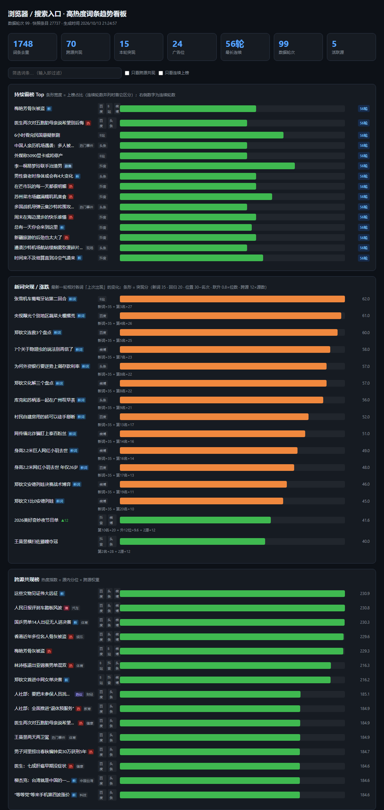

# 浏览器/搜索入口高热度词条采集（hotwords）

按源配置声明式组织的热榜采集骨架。**V3**：
5 个源（百度 4 榜 + B站 + 微博 + 抖音 + 头条）、**跨源共现**、
**持续上榜追踪**、**突现 / 涨跌检测**、**趋势看板（含搜索筛选）**，
实测 **280 条/轮、status=ok**。

参考 Scrapling 的能力边界设计，但**只用它的 `Fetcher`**（TLS 指纹 + 统一 API），
不引入 StealthyFetcher / adaptive —— 本项目的源几乎全是 JSON 接口，
反爬对抗与 DOM 自适应都用不上（详见"选型说明"）。



<sub>看板上半部分：顶部统计 → 持续霸榜 → **新词突现 / 涨跌**（橙色为全新词，条形下方直接打印得分构成）。完整看板另有跨源共现、位置与性质标记、排名走势、突现词轨迹、各源采集量 5 个视图，`python -m hotwords trend` 生成。</sub>

---

## 快速开始

```bash
# 1. 安装依赖（建议先建虚拟环境）
pip install -r requirements.txt

# 2. 常用命令
python -m hotwords sources    # 列出已配置的源
python -m hotwords once       # 跑一轮采集（自动更新持续追踪）
python -m hotwords track      # 持续上榜榜（"长期"，靠跨轮累加）
python -m hotwords emergence  # 突现/涨跌榜（"此刻"，只看最新一轮相对上次）
python -m hotwords cross      # 跨源共现榜（默认聚合全部轮次）
python -m hotwords trend      # 生成趋势看板 dashboard.html（默认全量）
python -m hotwords report     # 数据概览
python -m hotwords run        # 常驻调度：每 N 分钟跑一轮全量
python -m hotwords retrack    # 从快照全量重建持续上榜数据
python -m hotwords alerts     # 查看告警

python tests/test_basic.py    # 27/27 通过
```

`cross` / `trend` 支持 `--last N` 只看最近 N 轮（默认 `0` = 全部）。
`emergence` 支持 `--limit N`（默认 30）与 `--min-score X` 过滤低分噪声。

Windows 下双击 `run.bat` 会出现交互菜单（选 1~7），
也支持 `run.bat once / track / emergence / cross / trend / report / retrack / run / test`。
选 7 挂机会同时把日志追加写入 `logs/scheduler.log`，便于次日回溯。

`run.bat` 按以下优先级挑解释器
（挑错会报 `ModuleNotFoundError: No module named 'yaml'`）：

```
%HOTWORDS_PY%  →  <项目>\.venv\Scripts\python.exe  →  <项目>\venv\...  →  PATH 上的 python
```

**推荐在项目里建 `.venv`**：依赖隔离、且双击即可用，不必记路径。
跑完菜单会打印实际使用的解释器，便于排查。

更详细的使用说明、典型场景与排查手册见 **[docs/USAGE.md](docs/USAGE.md)**。

---

## 四个"热度"视角（别混淆）

| 视角 | 问题 | 方法 | 抗噪性 |
|---|---|---|---|
| **单源排名** | 这个词在这个平台排第几 | 直接读 rank | ❌ 平台各自为政 |
| **跨源共现** | 多个平台是否同时上榜 | 源内分位 × `1+log2(源数)` | ⚠️ 单轮可能是巧合 |
| **持续上榜** ⭐ | 是否**连续多轮**都在榜 | `persistence_score` | ✅ **最强信号** |
| **突现 / 涨跌** | 此刻**什么正在爆发** | `emergence_score` | ✅ 抢新（看长尾用持续度） |

前三者回答"这个词**长期**怎么样"，第四个回答"**此刻**发生了什么"。
两套判据的输入相同（都是 snapshot），但一个看**历史长度**、一个看**瞬时变化**，
所以 `analysis.py` 与 `emergence.py` 分开，互不借用对方的分数。

**为什么不能用持续度反着看突现**：持续度对新词**天然不利** —— 刚上榜的词
累加轮数少、覆盖度低，分数一定排在老词后面；而"什么正在爆发"恰恰要放大新词。
反过来也一样：突现分只看这一轮，长期钉子（运营位）在它眼里毫无特殊性。

**为什么持续度最强**：某词"刚好两源同时出现"可能是一次巧合，
但**连续 5 轮都在榜**几乎不可能是噪声。

`persistence_score`（0~150）权重设计：
连续轮数 35% + 历史最长连续 20%（抗短期中断）+ 上榜占比 20%
+ 最佳名次 15% + 跨源广度 10%。

`track_persistence()` 在每轮采集后**增量更新**（不全表重算）：
- 本轮上榜 → `total_rounds+1`，若上轮也在榜则 `streak+1`
- 本轮未上榜 → `streak` 归零（**断档检测**）
- 与上轮间隔 > `MAX_GAP_MINUTES`（默认 180 分钟）→ 视为**中断**，`streak` 重置
  （否则"停一晚再挂"会被误算成连续，见坑 14）

历史数据可用 `python -m hotwords retrack` 从快照全量重放重建。

### 突现 / 涨跌（`emergence`）

回答"**最新一轮里什么在爆发**"。只看**最后一轮**相对各词**上次出现**的变化，
不做跨轮累加 —— 这是它与持续榜最大的区别。核心是三个可观测事实：

1. 它是不是**刚出现**（全新 / 断档后回归）
2. 它出现时**站在什么位置**（首秀即前 10 名，比首秀 45 名强得多）
3. 它**同时在几个源**出现（跨源共现几乎不可能是巧合）

`emergence_score` 刻意做成**可手算的线性加权**，不做黑盒：

| 信号 | 加分 | 说明 |
|---|---|---|
| 新词 | **+35** | 历史首次出现 |
| 断档后回归 | **+20** | 之前出现过，中间断了 ≥1 轮 |
| 位置强度 | **+(30−rank)** | 仅 rank<30 计分，第 1 名 → +29 |
| 名次跃升 | **+min(Δ,30)×0.8** | 仅当上轮也在榜且名次上升 |
| 跨源广度 | **+12×(源数−1)** | 当轮同时在多个源出现 |

取值范围 0 ~ 约 135。每条的**得分构成都会原样打印**，方便解释"为什么它排在前面"：

```
$ python -m hotwords emergence --limit 60
共 99 轮数据，下面是最新一轮相对各词上次出现的突现 / 涨跌：

（已排除运营位榜单: baidu_hot/movie, baidu_hot/novel, baidu_hot/teleplay）
（已排除活动话题徽标: douyin_hot[9=挑战]）

词条                        名次    上轮    断档    跃升    源   分       构成
------------------------------------------------------------------------------------------------
张雪机车葡萄牙站第二回合              3     —     新     —     1   62.0    新词+35 + 第3名+27
央视曝光个别地区蔬菜大棚撂荒            4     —     新     —     1   61.0    新词+35 + 第4名+26
郑钦文连救3个盘点                 5     —     新     —     1   60.0    新词+35 + 第5名+25
            ……（中间 17 行同为全新词，略）……
2026美好奇妙夜节目单              10    22     0    +12    2   41.6    第10名+20 + 升12位+9.6 + 2源+12
王曼昱横扫佐藤瞳夺冠                2     2     0      0    2   40.0    第2名+28 + 2源+12
人民日报评刹车踏板风波               6    10     0     +4    2   39.2    第6名+24 + 升4位+3.2 + 2源+12
成都AG超玩会 vs 长沙TES.A KPL    2     12     0    +10    1   36.0    第2名+28 + 升10位+8.0
珊子锐评时代峰峻                  17    20     1     +3    1   35.4    断1轮后回归+20 + 第17名+13 + 升3位+2.4
```

> `断档=新` 表示"从未出现过"，`上轮/跃升` 为空（`—`）同理 —— 全新词没有
> "上轮"，就不该编一个 delta 出来。`断档=0` 则是"上轮也在榜"（连续）。
>
> 排除清单与持续榜**共用同一份**（`track_exclude` + `track_exclude_labels`）。
> 口径必须一致：同一个库若两张榜排除的东西不同，用户会以为其中一张算错了。
> `emergence` 与 `retrack` 都由同一个函数回显排除项，避免措辞漂移。

**failed 轮不参与判定**：某轮采集失败时快照里没有任何词，若把它算进去，
所有词都会被误判成"断档一轮"，回归加分凭空多出 +20。

### ⚠️ 运营推广位必须排除（`track_exclude`）

**持续度算法有个天然缺陷**：它的两个高权重项（连续轮数 35%、最佳名次 15%）
恰好是**平台运营位最强的项** —— 钉子榜永远在榜、永远排第一。

实测（2026-10-09~10，42 轮 / 6.5 小时）：

| 榜单 | #1 保持时长 |
|---|---|
| 百度 `movie` | 「功夫女足」**39/39 轮**纹丝不动 |
| 百度 `novel` | 「绍宋」**39/39 轮** |
| 百度 `teleplay` | 「九门」**39/39 轮** |
| 百度 `realtime` | 只保持 **20/39 轮**（真实热搜换得勤） |

不排除的后果：这些运营位会以接近满分的持续度**霸占榜单前十几位**，
把真实跨源热点（如台湾 3 源共现的「林诗栋退出亚锦赛男单混双」）挤出榜单。

**解决**：在 `sources.yaml` 里给源加 `track_exclude` 标记：

```yaml
- id: baidu_hot
  tabs: [realtime, teleplay, movie, novel]
  track_exclude: [teleplay, movie, novel]   # 不参与持续上榜统计
```

注意：**数据仍照常采集入库**，只是不参与 `word_track` 统计 ——
快照层保留完整证据，分析层不被污染。改完记得 `retrack` 重建：

```
python -m hotwords retrack     # 会打印本次排除的榜单与徽标
```

这套机制只能**整榜**排除。当"运营位"是**条目级**的时候（同一个榜单里
活动话题与真实热搜混在一起），要用下文的 `track_exclude_labels`。

### 位置与性质标记（广告位 / 置顶 / 内容分类 / 平台徽标）

热度值之外还有一层同样重要的信息：**这条是平台自己标出来的什么性质**。
它们此前一直埋在 `raw` JSON 里没被提取，现已独立成列
（`snapshot` 的 `is_ad` / `is_top` / `topic_category` / `label_id` / `sub_board`，
`word_track` 同步累积 `labels`）：

| 标记 | 来源字段 | 实测规模（全库 27457 条） |
|---|---|---|
| `is_ad` | 微博 `is_ad` / `topic_ad` | 54 条 |
| `is_top` | 百度 `isTop`、头条 `fixed_top_data` | 43 条 |
| `topic_category` | 头条 `InterestCategory`、微博 `flag_desc` | 2113 条 |
| `label_id` + `label` | 抖音 `label`（徽标枚举，见下） | 4745 条 |
| `sub_board` | 抖音 `word_sub_board` | 753 条（全部 = `[3]`，且全部是「挑战」） |

**为什么不塞进 `label`**：`label` 是平台给的展示文案，运营随时会改
（实测头条同一语义在 `Label` 里是英文枚举、在 `LabelDesc` 里是中文）；
而"这条是广告位""这条是置顶"是**结构性事实**，单列之后可以直接用
SQL 过滤统计，不必回头解析 raw。
`label_id` 与 `label` 分开也是同一个道理：中文名是我们自己定的映射，
机器判据（配置里的排除规则）必须挂在平台给的数字上，否则改个措辞就会静默失效。

微博广告位的判据：`is_ad=1` 的条目清一色是品牌代言 / 上市推广
（「迪丽热巴阿道夫品牌全球代言人」「谢霆锋同款银河战舰700全球上市」），
且这些条目**同时缺失 `realpos`** —— 接口不给"榜内真实位置"，
本身就是广告位的旁证。

#### 抖音徽标枚举是**看图看出来的**，不是猜的

`label` 是抖音内部数字枚举，官方从未公开语义。这里经历过一次立场转变，值得记下：

| 阶段 | 做法 | 依据 |
|---|---|---|
| 早期 | 只映射 `1→新`、`3→热`，其余留空 | 样本印象，**不足以定论** —— "猜错会把真实热点标成广告，比不标更糟" |
| 现在 | 8 个值**全量映射** | 徽标图可下载、可肉眼确认，**不再有猜测成分** |

关键发现：每条带 `label` 的条目都附了徽标图 URL，**文件名就是 label 值本身**：

```
https://lf3-static.bytednsdoc.com/obj/.../hotspot_detail_page/<label>.png
```

下载放大后语义无可争议：

| label | 1 | 3 | 5 | 8 | 9 | 11 | 16 | 17 |
|---|---|---|---|---|---|---|---|---|
| 徽标 | **新** | **热** | **首发** | **独家** | **挑战** | **剧集** | **辟谣** | **热议** |

> 中途还走过一个弯路：这些值恰好是 `1/3/5/8/9/11/16/17` 这种稀疏集合，
> 看着很像位掩码（1|2、8|1 之类），一度按位掩码去解释。**猜错了** ——
> 缺失的 2/4/6/7/10/12 只是没用到的枚举 id。
> 教训：**"数值长得像位掩码"不是证据，把图下下来看才是。**

#### 条目级排除（`track_exclude_labels`）

「挑战」（label=9）是抖音官方活动话题，不是突发热点。判据：

- 745 条**全部**带 `word_sub_board=[3]`，而 `word_sub_board` 全库只有
  `None` 与 `[3]` 两个值；229 个词条里 **0 个**在两者之间切换过
  → 它是词条的**稳定属性**，不是动态状态，即独立子榜
- 95.8% 带 `post_aweme_info`（挑战话题绑定的 BGM）
- 出现轮数最长的抖音词几乎全是「挑战」：「这就是宿命般的对视」79/98 轮、
  「我家萌宠养着不烧心」72/98 轮

所以按**条目**排除（不是整榜排除 —— 挑战条目与真实热搜混在同一张榜里）：

```yaml
track_exclude_labels: [9]     # douyin_hot
```

排除后抖音参与统计的词条 229 → 203，持续榜前排立刻从活动话题换成真实跨源热点。
数据仍**照常采集入库**，看板「位置与性质标记」里单独成组展示。

> ⚠️ **改排除清单后必须跑一次 `python -m hotwords retrack`**，否则历史轮次
> 的统计口径与新规则不一致。`retrack` 会把排除项翻译成中文回显（如
> `douyin_hot[9=挑战]`），不必回去翻 `labels.py`。

> 老库的回填：这些字段的信息一直在 raw 里，加列后可用一次性脚本从 raw
> 重算回填（本项目已回填 27457 行、其中 4745 行抖音条目补齐徽标），
> 然后 `retrack` 让 `word_track` 同步。

---

## 趋势看板（`dashboard.html`）

自包含 HTML（内联 CSS/JS，无 CDN，**离线可用**），暗色主题：

| 视图 | 内容 |
|---|---|
| **持续霸榜 Top** | 条形宽度 = **上榜占比**（连续轮数并列时靠它区分），右侧数字为连续轮数，绿≥3轮 / 黄=2轮 / 蓝=1轮 |
| **新词突现 / 涨跌** | 最新一轮的突现分榜；橙=全新 / 紫=断档回归 / 绿=连续在榜但窜升，条形下方直接打印得分构成 |
| 跨源共现榜 | 绿=多源共现 / 蓝=单源 |
| **位置与性质标记** | 广告位 / 置顶 / 活动话题单列（平台标记，非算法推断） |
| 排名走势 | 跨源 Top 词条各轮最佳名次折线 |
| 突现词轨迹 | 突现词的近 20 轮名次折线（只画**有历史**的突现词，全新词无轨迹可画） |
| 各源采集量 | 堆叠柱，健康度监控 |

> 折线图里 `None`（该轮不在榜）**必须断开**，不能连成直线 ——
> 否则会假造出"一直在榜"的错觉。排名走势与突现词轨迹共用同一个绘图函数，
> 就是为了让这条断线语义只在一个地方实现。

词条后面会挂**标记徽章**：`广告`（橙）/ `置顶`（金）是结构性事实，
平台标签（`新`/`热`/`沸`/`爆`/`辟谣`…）与内容分类（`国际`/`财经`…）用低对比度，
避免抢主线信息的注意力。详见下方「位置与性质标记」。

顶部工具栏：**词条搜索框**（实时过滤）+ 「只看跨源共现」/「只看连续上榜」勾选。

默认聚合**全部轮次**（`trend --last N` 可改为只看最近 N 轮；`--last 0` = 全量）。
> 早期版本固定只看最近 20 轮，长跑后顶部"累计词条"会远小于实际
> （实测 42 轮的库显示 531，而全库 932），属于误导性数字，已改为默认全量。

---

## 架构

```
调度层   scheduler.py    APScheduler；**整轮全量**、max_instances=1 禁止并发
                         （"每源一个 job"会毁掉 streak，见坑 13）
   ↓
采集层   collector.py    Fetcher 优先级：scrapling > curl_cffi > httpx > requests
                         指数退避重试；403/401 不重试
   ↓
解析层   parsers/        每源一个 Parser。只做 "原始 -> HotItem"，不发请求
   ↓                    （徽标/分类枚举的中文名统一放 labels.py，避免各处各存一份）
断言层   assertions.py   结构哨兵：条目数 / 必填字段 / 空词条
   ↓
分析层   analysis.py     跨源共现 + 持续上榜追踪（增量更新，"长期"）
         emergence.py    突现/涨跌（只看最新一轮相对上次，"此刻"）
                         两者共用 _exclude_clause 与 config 里同一份排除清单
   ↓
存储层   storage/        snapshot + word + word_track + alert + 指纹（6 张表）
   ↓
展示层   render.py       趋势看板 HTML（`trend` 传 config，保证与 CLI 口径一致）
   ↓
告警层   notify.py       解析失效 / 字段漂移 -> 日志 / alert 表
```

**Fetcher 档位**（auto 优先级）：
- `scrapling` — 完整框架，TLS 指纹 + 浏览器能力（依赖重）
- `curl_cffi` — **轻量 TLS 指纹，仅几 MB，无浏览器**（大多数场景够用）
- `httpx` / `requests` — 无指纹伪装，纯兜底

**关键解耦**：Parser 不碰网络，Collector 不碰解析。
→ 将来把 `static_json` 换成浏览器渲染，解析逻辑一行不用改。

---

## 源配置（`hotwords/config/sources.yaml`）

新增一个源 = **改配置 + 注册 Parser**，主流程零改动。

| 源 | 状态 | 实测条目 | 备注 |
|---|---|---|---|
| `baidu_hot` | ✓ | 101（4 榜） | realtime 无热度值 |
| `bilibili_hot` | ✓ | 30 | 最稳最快，0.2s |
| `weibo_hot` | ✓ | 50 | 需 Referer + 手机 UA |
| `douyin_hot` | ✓ | 50 | — |
| `toutiao_hot` | ✓ | 50 | 字段首字母大写 |
| `zhihu_hot` | ✗ | — | 401 需登录态 |

---

## 实测踩坑记录（2026-10-09 / 10-10 / 10-11）

这一节是最有产出的部分 —— 都是真机跑出来的，不是推测。

### 坑 1 · 百度接口多套一层 `content`
真实路径 `data.cards[0].content[0].content[]`，
**直接取 `data.cards[0].content` 会拿到 0 条**。

### 坑 2 · 同接口不同榜单，字段名不同 ⭐
| 榜单 | 字段 |
|---|---|
| `realtime` | `word` |
| `teleplay`/`movie`/`novel` | `title` |

同一 URL、同一层级，字段名居然不一样。**这是 adaptive 完全救不了的**
（它只处理 DOM 结构漂移，不处理 JSON 字段改名）。
解法：Parser 字段兼容 + 断言 `required_fields_any`。

### 坑 3 · 百度热度值是 dict 不是数字
`hotScore = {"type":0,"value":"95471","desc":"热搜指数"}`，直接 `int()` 丢数据。

### 坑 4 · 百度 `realtime` 榜压根没有热度值
只有 `word`/`url`/`isTop`。**这不是 bug，是数据事实**。

### 坑 5 · `normalize_hot_value` 对 dict 静默产错值
`str({'value':'1'})` 里的 `1` 被正则匹配 → 返回 1。
加类型防护 + 改 `fullmatch`。**靠自写测试才发现**。

### 坑 6 · 漂移检测误报
百度各榜字段天然不同，按"整个源"记指纹必然全报漂移。
改成按 `source/category` 维度记录。

### 坑 7 · 百度接口偶发超时返回空
手动测成功、批量跑却空 —— 网络抖动，**重试机制的价值所在**。

### 坑 8 · 头条字段名首字母大写，断言也要对上
`Title`/`HotValue`/`Url`。断言查的是**原始 raw 字典**，配置必须写
`required_fields: [Title]`。另有 `fixed_top_data` 置顶、`Label` 英文枚举需映射 ——
原映射表只覆盖 `new/hot/boom/top/recommend`，实测还有
`refuteRumors`/`depth`/`onSite`/`recentProgress` 四个漏网的会**原样吐成英文**；
现已补全，并优先采用现成的中文 `LabelDesc`（`LabelDesc` 的 35.7% 出现率
与 `Label` 非空比例完全一致，两者一一对应）。

### 坑 9 ⭐ · UNIQUE 约束导致**静默数据丢失**（最严重）
原约束 `UNIQUE(source, category, rank, fetched_at)` ——
**同一秒内跑两轮，第二轮数据被 `INSERT OR IGNORE` 静默吞掉**，
表现为"词条 streak 永远涨不上去"。
→ 改为 `UNIQUE(run_id, source, category, rank, word)`。
**`run_id` 才是"哪一次采集"的权威标识，不能用时间戳代替。**

### 坑 10 · `ORDER BY started_at` 排序退化
同一秒内多轮时时间戳相同，`prev_run` 会选错轮次 → streak 断档判断失效。
→ 统一改用 `rowid`（插入顺序），不依赖时间戳。

### 坑 11 · `list - set` TypeError
`sorted(...)` 返回 list，却直接做 set 差集运算。必须先差集再排序。

### 坑 12 ⭐ · 挂机时 SQLite 跨线程 + 异常被吞成"成功"（2026-10-10）
APScheduler 在**线程池**里执行 job，而 SQLite 连接建在主线程 ——
默认 `check_same_thread=True` 时第一轮就抛 `ProgrammingError`。

**真正阴的是表现形式**：异常被 job 内的 `try/except` 吃掉后，
APScheduler 照样打出 `Job executed successfully`，而数据库一轮都没涨。
**"库不涨、日志说成功"，不实测根本发现不了。**

→ 两处修正：`sqlite3.connect(..., check_same_thread=False)`
（安全性依据：单 job、`max_instances=1`，同一时刻只有一个线程在写）；
job 内**不捕获异常**，交给 APScheduler 记录 traceback 并继续调度。

### 坑 13 ⭐ · "每源一个 job"会毁掉持续上榜数据（2026-10-10）
原设计每个源各自建一个 run。但 `track_persistence(run_id)` 的语义是
"用**这一轮 run 的全部快照**比对上一轮，本轮没出现的词判为断档"。

于是：run A 只有百度 → 微博/抖音/头条的词全被清 `streak`；
下一轮 run B 只有 B站 → 百度的词又被清。**跑几轮数据就废了。**

而且每源独立 job 时根本**没有"轮"的边界**，`track_persistence` 无处触发 ——
挂一夜，`word_track` 一轮都不会更新。

→ 调度改为**整轮全量**：一个 job、一个 run、覆盖全部源。
整轮间隔取各源 `interval_min` 的**最大值**（默认 10 分钟），
即不对任何源加速（微博/抖音/头条当初就是为合规主动降频到 10min 的）；
需要更快用 `--interval N` 覆盖。

### 坑 14 ⭐ · 跨天被误判为"连续"（2026-10-10）
`track_persistence` 只按 `rowid` 找上一轮，**不看时间间隔**。
实测两轮相隔 **19 小时**仍被当作相邻轮次，`streak` 从 6 涨到 7 ——
而"白天关机上课、晚上再挂"正是常态，这会让挂机产出的核心指标
（连续上榜）整体虚高。

→ 引入 `MAX_GAP_MINUTES`（默认 180）：相邻两轮间隔超过该值即视为中断，
`streak` 重置；时间戳缺失/无法解析时**按中断处理**（宁可重置，
也不让坏时间戳撑出虚高记录）。

配套 `python -m hotwords retrack`：从 snapshot 全量重放重建 `word_track`，
用于修正历史脏数据或调整算法后重算。

### 坑 15 ⭐ · 平台运营位污染持续上榜榜（2026-10-10）
`persistence_score` 的两个高权重项（连续 35% + 最佳名次 15%）
恰好是运营位最强的项 —— 钉子榜永远在榜、永远第 1。

实测：百度 `movie`/`novel`/`teleplay` 三个垂类榜的 #1 在 **39/39 轮**
纹丝不动（功夫女足 / 绍宋 / 九门），而 `realtime` 榜 #1 只保持 20/39 轮。
结果 **Top20 里 15 个是运营位**，占据了 #1~#18，真实跨源热点被挤出榜单。

→ 引入 `track_exclude`（源配置里的 tab 黑名单），只排除**统计**不排除**采集**：
```
baidu_hot: track_exclude: [teleplay, movie, novel]
```
重建后榜单立刻恢复信息量（跨 2~3 源的真实热点排到前面）。
`track_persistence` / `rebuild_track` 新增 `exclude` 参数，
`pipeline` 自动从配置注入，`retrack` 会打印本次排除项。

### 坑 16 · 看板只统计最近 20 轮（2026-10-10）
`render_dashboard(last_n=20)` 与 `load_snapshot_over_runs(last_n)` 默认
只取最近 N 轮，长跑后看板顶部"累计词条"远小于实际
（42 轮的库显示 **531**，全库 **932**），属于误导性数字。

→ `last_n <= 0` 语义改为**全量**，并把 `trend`/`cross` 的默认值改成 0。
现在看板 KPI 为 929 词条 / 26 条跨源共现 / 11,810 行 / 42 轮，
与数据库逐项对得上。

---

### 坑 17 ⭐ · 项目目录含中文 → curl_cffi 全线抓取失败（2026-10-11）

所有源同时失败，第一反应像"被封了"，实际报的是：

```
curl: (77) error adding trust anchors from locations:
      CAfile: E:\<中文目录>\.venv\Lib\site-packages\certifi\cacert.pem
```

**根因**：libcurl 在 Windows 上打不开**非 ASCII 路径**的 CA 文件。
本项目正好落在一个中文目录里，certifi 给出的路径就带着中文。

交叉验证（同一份 pem、同一个 URL、只改 verify 参数）：

| verify 参数 | 结果 |
|---|---|
| 默认（certifi 的中文路径） | ❌ curl 77 |
| 显式传 ASCII 路径的同一份 pem | ✅ 200 |
| `verify=False` | ✅ 200（**但这是关掉证书校验，不能用**） |

→ 在 `collector.ca_bundle_arg()` 里处理：路径含非 ASCII 时把 pem 复制到
`%LOCALAPPDATA%\hotwords\cacert.pem` 再引用；**绝不退回 `verify=False`**
（那是安全倒退），复制失败宁可沿用原路径、让请求失败，也不降低校验强度。

⚠️ 这个坑只在"项目目录是中文 **且** 用 `.venv` 里的解释器"时暴露 ——
所以它之前 42 轮挂机一直是好的（当时用的是另一个路径全 ASCII 的解释器），
属于典型的**换环境才现形**。任何把项目放在中文目录的人都会撞上。

### 坑 18 ⭐ · 漂移检测被"可选字段"刷屏（2026-10-11）

坑 6 把指纹按 `source/category` 拆开，解决了"不同榜单字段不同"；
但**同一榜单的字段也在时有时无** —— 各源都有可选字段：

| 源 | 可选字段（出现率） |
|---|---|
| weibo | `is_ad` 2.5%、`topic_ad` 1.3%、`flag_desc` 18%、`icon*` 56% |
| douyin | `label_url` 63%、`word_sub_board` 13%、`post_aweme_info` 12% |
| toutiao | `InterestCategory` 80%、`LabelDesc` 36% |
| baidu | `newHotTag` 14%、`labelTag` 5% |

于是**每轮字段集合都不一样**，每轮都报漂移。实测 42 轮里积了
**24 条 `schema_drift`（微博 22 + 抖音 2）**，全是这类噪声 ——
真正需要看的漂移会淹没在里面，典型的"狼来了"。

→ 判据从"字段集合是否相等"改成两条：
1. **关键字段缺失**（关键字段直接复用断言配置 `required_fields` /
   `required_fields_any`，不再另维护一份清单）；
2. **字段集合大面积换血**（旧字段消失 >50%）作为兜底，防止
   "关键字段恰好没变、但整个结构已经换了"的漏网。

⚠️ 一个差点踩回去的坑：百度只配了 `required_fields_any: [word, title]`，
而 `required_fields` 的默认值仍是 `["word"]`。若直接把它当 `must_have` 传进去，
三个垂直榜（字段是 `title`）会每轮误报"关键字段缺失: ['word']" ——
等于把刚修好的噪声换了个来源。所以配了 `any_of` 的源不再套用 `must_have`。

→ 效果：修复后再跑 2 轮采集，`schema_drift` **0 条**（此前微博每轮必报）。

---

### 坑 19 ⭐ · 停跑却无法归因：APScheduler 把 Ctrl+C 吞掉了（2026-10-11）

挂机到 10:58 突然停了，而**日志干净地断在"最后一轮成功"的尾巴上**：
没有 traceback、没有 `调度器已停止`、Windows 事件日志零错误、电源事件显示
期间从未休眠、那个 cmd 窗口还活着停在 `Press any key to close`。

`scheduler.py` 里明明写着

```python
try:
    sched.start()
except (KeyboardInterrupt, SystemExit):
    logger.info("调度器已停止")
```

但这一行**从来没有出现在日志里** —— APScheduler 的 `BlockingScheduler.start()`
自己就消化了 Ctrl+C，根本不会抛到我们的 `except`。于是"崩溃"与"被人按了
Ctrl+C"在日志上**完全无法区分**，最后是靠逐行比对昨天手动 Ctrl+C 的日志签名
（同样断在 `Job executed successfully` 之后、同样没有停止那一行）才推断出是人按的。

对一个要挂十几小时、无人值守的工具，这种盲区不可接受。补三层，各管一类退出：

| 层 | 位置 | 负责的退出方式 |
|---|---|---|
| 信号处理（SIGINT / SIGTERM / SIGBREAK） | `scheduler._install_exit_diagnostics` | Ctrl+C、Ctrl+Break、关闭控制台 |
| `atexit` | 同上 | 任何正常退出（含 `sys.exit`） |
| `faulthandler` | `__main__._setup_logging` | 原生崩溃（libcurl 段错误这类没有 Python traceback 的） |

效果——现在停跑会留下确定痕迹：

```
WARNING hotwords.scheduler | 调度器收到信号 SIGINT，正在停止 —— 这是被中断，不是崩溃
WARNING hotwords.scheduler | 调度器进程退出（atexit）
```

若只看到 atexit 那行、没有"收到信号"，那就是被强杀（`taskkill /F`、任务管理器）
或原生崩溃；后者还会有 traceback 落在 `logs/scheduler.log.crash`。

`run.bat` 同时把退出码追加进 `logs/last_exit.txt`，用于区分"干净退出"与"非零退出"。

### 坑 20 · `%VAR%>>file` 在 cmd 下重定向**静默失效**（2026-10-11）

给 `run.bat` 加退出码记录时写的是：

```bat
echo %DATE% %TIME%  exit code=%RC%>>"logs\last_exit.txt"
```

实测结果：**输出跑到控制台、变量展开成空、目标文件 0 字节** —— 三个错误同时发生，
却没有任何报错。穷举对比后确认 `%RC%` 紧贴 `>>` 时 cmd 不识别重定向：

| 写法 | 结果 |
|---|---|
| `echo x=%RC%>>"f"` | ❌ 文件空，内容跑到控制台，`%RC%` 为空 |
| `echo x=%RC% >>"f"` | ✅ 正常写入 |
| `>>"f" echo x=%RC%` | ✅ 正常写入 |
| `(echo x=%RC%)>>"f"` | ✅ 正常写入 |

**`%RC%` 与 `>>` 之间那个空格是必需的**，不是风格问题。

另一个连带发现：`%DATE%` 在中文 Windows 下是 `2026/10/11 周日`，那个星期几
按 GBK 写进文件就是乱码。改用 `%DATE:~0,10%` 只取日期部分，得到纯 ASCII。

---

### 坑 21 ⭐ · 抖音 `label`：以为是位掩码，其实是枚举（2026-10-11）

`label` 是抖音内部数字枚举，官方无文档。全库出现过的值是
`0/1/3/5/8/9/11/16/17` —— 一个稀疏集合，看着极像位掩码
（`3=1|2`、`9=8|1`、`5=1|4`、`11=8|2|1`…），一度真按位掩码去解释。

**做了一次可证伪的检验，假设当场倒掉**：若某个 bit 表示"新"，那么带该 bit 的
条目应当在**本轮新进入榜单**的条目里显著富集。实测（98 轮 4745 条）：

| 分组 | 条目数 | 新进入占比 | 相对基线 |
|---|---|---|---|
| 基线（全体） | 4695 | 7.2% | 1.00x |
| bit0(=1) | 3061 | 6.7% | 0.94x |
| bit1(=2) | 1670 | 5.6% | 0.78x |
| bit2(=4) | 128 | 7.0% | 0.98x |
| bit3(=8) | 952 | 3.9% | **0.54x** |
| bit4(=16) | 155 | 5.2% | 0.72x |

**没有任何一个 bit 在这个维度上富集**，全部落在 0.5~1.2x 之间 —— 位掩码解释不成立。

真正的证据来得比推理简单得多：**每条带 label 的条目都附了一个徽标图 URL，
文件名就是 label 值**：

```
https://lf3-static.bytednsdoc.com/obj/.../hotspot_detail_page/<label>.png
```

把 8 张图下载、放大 8 倍、拼成对照图之后，语义一眼可读：

| label | 1 | 3 | 5 | 8 | 9 | 11 | 16 | 17 |
|---|---|---|---|---|---|---|---|---|
| 徽标 | 新 | 热 | 首发 | 独家 | 挑战 | 剧集 | 辟谣 | 热议 |

那些"缺失"的 `2/4/6/7/10/12…` 只是没用到的枚举 id，不是位组合。

**教训有两层**：

1. **"数值长得像位掩码"不是证据。** 稀疏的 2 的幂组合看起来很像，但能被
   一个简单统计检验反驳。花了时间去建模的结构，先证伪比先解释便宜。
2. **数据自己会带答案。** 前面所有基于内容语义的推测（"label=9 像推广位"）
   都是样本印象；而 `label_url` 这个字段一直躺在 raw 里，从第一天起就在
   告诉我们答案 —— **解析 raw 时把所有字段都列出来看一眼**，比事后围着
   几个可疑字段猜要省事得多。

顺带定下「挑战」的处置：见上文「条目级排除」。也顺带修掉一个看板缺陷 ——
长跑到 98 轮后持续榜 Top15 的连续轮数会全部并列（都是 55 轮），条形图全满格
失去信息量。先后试过用持续度得分当宽度（这些词本就是近乎并列的真平局，
只差 4%，等于没修），最后改用**上榜占比**（差距 56%~78%，真实且有意义的区分度）。

---

### 坑 22 ⭐ · 看板横轴编号：两张图各算各的，叠加还叠成一团（2026-10-13）

长跑到 99 轮后，看板三张图的横轴同时出问题，而且是**两个独立的 bug**：

**(1) 固定步长不随轮次增长**。刻度挑拣写的是 `if(labels.length>8 && i%2!==0) return`
—— 只在 9~16 轮时刚好够用。49 轮时它仍会排出 25 个标签，而绘图区只有 ~500px
（每标签约 20px，`#41` 这种文本本身要 ~30px）→ 直接叠成一条灰带。
再加上坐标是小数，亚像素渲染又糊了一层，"编号清晰"变成了"看不出是几个字"。

改成先量最宽标签、再算步长：

| 轮次 | 旧行为 | 新行为 |
|---|---|---|
| 12 | 12 个标签（勉强） | 12 个（间距 45.5px） |
| 49 | 25 个（**重叠**） | 17 个（间距 31.3px > 需要的 29.8px） |
| 120 | 60 个（**糊成一片**） | 14 个（间距 37.8px） |

末轮一定保留（否则右端看着像数据缺了一段），坐标一律 `Math.round`。

**(2) 同一页两张图横轴口径不同**。折线图用看板自己算的 `run_labels`
（密集时切成 `#N`），生命曲线却用 `emergence.rank_series` 返回的
`started_at[5:16]`，再被 `slice(0,5)` 砍一刀 → **20 轮全在同一天，9 个标签全是
`10-11`**。左图 `#37`、右图 `10-11`，读者没法把两张图对上。

修法是让两边共用一套：`rank_series` 只返回**未格式化的 `started_at` 全值**
（怎么截断是展示层的事），看板统一走 `_axis_labels()`，生命曲线直接切
`run_labels` 的末 N 项。切片能对齐的前提是**两个查询的过滤条件与排序键一致**——
原先 `_run_index` 按 `rowid` 排、看板按 `started_at` 排，只是碰巧一致；
现在都写成 `ORDER BY started_at, rowid`，一致变成结构性的，不再依赖巧合。

两条教训：**"短跑时能用"的常量，长跑后一定会失效**；以及**同一页上的同类元素
必须共享同一套口径**，各写一份迟早会对不上（而且是不报错的那种对不上）。

---

## 选型说明（为什么只用 Scrapling 的 Fetcher）

| Scrapling 能力 | 本项目用不用 | 原因 |
|---|---|---|
| `Fetcher`（TLS 指纹） | ✅ 用 | 微博要的 Referer+UA 它天生支持 |
| `FetcherSession` | ✅ 可扩展 | 会话保持 |
| `DynamicFetcher` | ⚠️ 备用 | 仅知乎等 JS 站可能需要 |
| `StealthyFetcher` | ❌ 不用 | 现有源**没有一个**上 Cloudflare |
| **adaptive 自适应** | ❌ 不用 | 源是 JSON 接口，失效表现为"字段改名/接口换掉"，adaptive 无效 |

**真正防失效的是**：结构断言 + 字段漂移告警 + 配置化 Parser。
坑 2 是最直接的实证 —— adaptive 对"同接口不同榜字段不同"毫无办法。

> 本机现状：已装 `curl_cffi`（轻量 TLS 指纹），未装 scrapling。
> 当前实际使用 `curl_cffi`，微博实测 200 / 50 条。

---

## 合规留档

| 源 | robots 探测（2026-10-09） |
|---|---|
| 百度 | `top.baidu.com/robots.txt` **404**；`www.baidu.com/robots.txt` 只约束 `/baidu`、`/s?`，**未覆盖本接口** |
| B站 / 微博 / 抖音 / 头条 | 公开接口 |

红线：不绕技术措施、不高频并发、不商用替代原站。
频率设为单源 5–10 分钟、串行、全局 1–3 QPS。**不引入代理池。**

---

## 下一步（V4）

1. 告警外发到 Agent Mail（`notify.make_mail_notifier` 已留口子）
2. 词条分类打标（先评估用途，别急着上模型）
3. 持续上榜的**趋势预警**：新词突入 Top / 老词掉榜提醒


